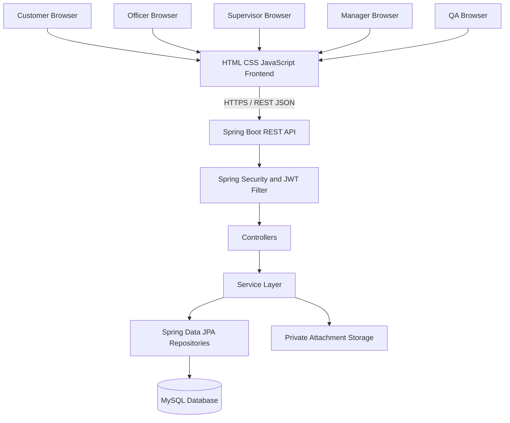

# SupportHUB

**Customer Support and Operations Management Platform**

SupportHUB is a web-based customer support platform built to manage customer enquiries, service tickets, support teams, service-level agreements, feedback, and operational reporting through role-specific workspaces.

The project uses a Java 17 and Spring Boot backend, a MySQL relational database, and a browser-based frontend built with HTML, CSS, and JavaScript.

## Project Overview

SupportHUB provides a central workflow for receiving customer requests, assigning and resolving tickets, communicating with customers, monitoring service performance, and reviewing service quality.

### User Roles

| Role | Main responsibilities |
|---|---|
| Customer | Register, sign in, create support tickets, attach files, view ticket progress, reply to support staff, browse FAQs and knowledge-base articles, and submit feedback. |
| Customer Service Officer | View permitted tickets, manage assigned work, communicate with customers, add internal notes, and process permitted ticket actions. |
| Operations Supervisor | Oversee service operations, manage support agents and categories, review team tickets, monitor SLAs, and handle escalations. |
| Customer Support Manager | Review operational reports, service configuration, customer satisfaction, team performance, and audit information. |
| Quality Assurance Executive | Review ticket handling, evaluate service quality, manage feedback reviews, and access QA reports and scorecards. |

Access is controlled by authenticated user roles and backend authorization checks. The frontend role-specific pages are not a substitute for server-side authorization.

## Technology Stack

### Backend
- Java 17
- Spring Boot 3.2.3
- Spring Web
- Spring Security
- Spring Data JPA
- Hibernate
- MySQL Connector/J
- JSON Web Tokens (JJWT)
- Bean Validation
- Maven

### Frontend
- HTML5
- CSS3
- Vanilla JavaScript
- Fetch API
- Browser local storage for the current client-side authentication token

### Database
- MySQL 8.0 or compatible MySQL server
- Relational entities and JPA repositories
- SQL schema and seed scripts in the `database` directory

## Architecture

The application follows a layered client-server architecture.



### Request lifecycle

1. A user opens the relevant SupportHUB page in a browser.
2. The frontend JavaScript sends an HTTP request to the configured backend API.
3. For protected requests, the client includes its JWT as a Bearer token.
4. The JWT filter validates the token and loads the authenticated user.
5. Spring Security checks whether the request is authenticated. Role and ownership rules are also enforced in the backend service/controller layer where applicable.
6. The controller validates request data and calls the relevant service.
7. The service applies business rules and accesses repositories.
8. Spring Data JPA communicates with MySQL.
9. The backend returns a JSON response.
10. The frontend updates the relevant page based on the response.

## Main Functional Areas

### Authentication and User Management
- User registration and login endpoints.
- Password hashing through Spring Security's BCrypt password encoder.
- JWT-based stateless authentication.
- Profile and password-related request models.
- Password reset request and reset token components.
- Role-aware access to application areas.

### Customer Management
- Customer records and profile information.
- Customer listing and filtering support.
- Customer status and inactivity-related processing.
- Customer order information used by support workflows.

### Ticket Management
- Ticket creation and category selection.
- Ticket priority and status management.
- Ticket assignment and permitted reassignment.
- Ticket replies and conversation history.
- Internal notes and customer-visible replies.
- Order, tracking, and refund-related fields.
- SLA due-time and escalation information.
- Ticket attachment handling.
- Ticket history and audit-related records.

### Support Agent Management
- Support agent records and status.
- Agent category assignments.
- Ticket assignment and team workload operations.
- Officer-specific ticket views and profile pages.

### SLA and Escalation
- SLA due-time calculation based on ticket priority.
- SLA monitoring and escalation-related workflows.
- Supervisor views for team tickets and escalations.

### Feedback and Quality Assurance
- Customer feedback and satisfaction records.
- Feedback review and reporting.
- QA scorecards and ticket review pages.
- Officer quality and satisfaction analysis views.

### FAQ and Knowledge Base
- Public FAQ and knowledge-base access.
- FAQ management.
- Knowledge-base article management.
- Search and matching services for self-service content.

### Notifications and Audit
- Notification records and notification endpoints.
- Ticket history.
- Audit log entities and repositories.
- Manager-facing audit and operational reporting pages.

## Repository Structure

```text
SupportHUB/
├── backend/
│   ├── pom.xml
│   └── src/
│       ├── main/
│       │   ├── java/com/customersupport/SupportHUB/
│       │   │   ├── agent/
│       │   │   ├── auth/
│       │   │   ├── category/
│       │   │   ├── common/
│       │   │   ├── customer/
│       │   │   ├── faq/
│       │   │   ├── feedback/
│       │   │   ├── notification/
│       │   │   └── ticket/
│       │   └── resources/
│       │       ├── application.properties
│       │       ├── application-prod.properties
│       │       └── META-INF/spring.factories
│       └── test/
│           └── java/com/customersupport/SupportHUB/
├── database/
│   ├── schema.sql
│   ├── seed.sql
│   └── reset.sql
├── frontend/
│   ├── css/
│   ├── images/
│   ├── js/
│   ├── customer/
│   ├── officer/
│   ├── supervisor/
│   ├── manager/
│   └── qa/
├── .env.example
├── .gitignore
└── README.md
```

## Database Model

The application uses MySQL with JPA entities and repositories. Core domain records include:

- Users and role information
- Customers
- Support agents
- Ticket categories
- Tickets
- Ticket replies
- Ticket history
- Attachments
- Feedback
- Notifications
- Audit logs
- FAQ and knowledge-base articles
- Ticket sequence records

The ticket sequence component uses a database-backed sequence entity and repository with pessimistic locking. The service allocates ticket numbers in a separate transaction using `REQUIRES_NEW`.

The supplied SQL scripts are:

| File | Purpose |
|---|---|
| `database/schema.sql` | Database schema setup |
| `database/seed.sql` | Initial/sample data |
| `database/reset.sql` | Reset operations; inspect carefully before use |

**Important:** Review the SQL scripts before running them against any database containing information you need to keep. Do not run reset scripts against a live or valuable database.

## Security Design

The source includes the following security mechanisms:

- Spring Security filter chain.
- Stateless session policy.
- JWT Bearer-token authentication.
- BCrypt password hashing.
- Role-based access configuration.
- Backend ticket access and ownership checks.
- Customer-visible reply/history filtering.
- Server-derived MIME types for supported attachment extensions.
- Attachment extension and content-signature checks.
- Attachment download authorization.
- Production configuration validation.
- Production JWT secret validation.
- Supervisor bootstrap credential provisioning.
- Restricted CORS configuration through configuration properties.

Security controls must be verified in the deployed environment. A frontend page being hidden does not prove that its API is protected.

## Ticket Processing: End-to-End Workflow

The typical ticket lifecycle is:

1. **Customer sign-in:** The customer authenticates and receives a JWT.
2. **Ticket submission:** The customer selects a category and enters the subject and description. Order or tracking details and an attachment may also be supplied.
3. **Backend validation:** The API validates the request, customer identity, category, category status, and any supplied attachment.
4. **Ticket number allocation:** The ticket sequence service allocates a ticket number using the database-backed sequence.
5. **Ticket persistence:** The ticket is saved with its customer, category, priority, initial status, and SLA information.
6. **Assignment and triage:** An authorized supervisor or service workflow assigns the ticket to an eligible officer.
7. **Officer review:** The officer views tickets permitted by the backend access rules.
8. **Customer communication:** The officer replies to the customer. Internal notes are handled separately from customer-visible replies.
9. **Status and SLA updates:** Ticket status and SLA-related information are updated through permitted operations.
10. **Resolution:** The ticket is resolved or closed according to the implemented workflow.
11. **Customer feedback:** The customer can submit feedback when the ticket meets the service's feedback eligibility rules.
12. **Quality and management review:** QA and management pages provide review, reporting, and operational oversight.

Actual status transitions and permissions are governed by the backend implementation, not by this high-level description.

## Local Development Setup

### Prerequisites

Install the following:

- JDK 17
- Apache Maven compatible with the project
- MySQL 8.0 or a compatible MySQL server
- A modern browser
- An IDE such as IntelliJ IDEA or Visual Studio Code

### 1. Create a development database

Create a database and a dedicated application user in MySQL. Use a unique local password and grant only the permissions needed for development.

Example database creation:

```sql
CREATE DATABASE customer_support_db
  CHARACTER SET utf8mb4
  COLLATE utf8mb4_unicode_ci;
```

Create the application user and grant permissions according to your local MySQL setup. Do not use the MySQL root account as the application account.

### 2. Configure environment variables

The repository includes `.env.example` as a reference. Spring Boot does not automatically load a `.env` file unless an additional loader or deployment mechanism is configured. Set the variables in your terminal, IDE run configuration, or hosting provider.

Required or relevant variables include:

| Variable | Purpose |
|---|---|
| `DB_URL` | JDBC URL for MySQL |
| `DB_USERNAME` | Database application username |
| `DB_PASSWORD` | Database application password |
| `JWT_SECRET` | Base64-encoded JWT signing key |
| `JWT_EXPIRATION_MS` | JWT lifetime in milliseconds |
| `SUPERVISOR_INITIAL_PASSWORD` | Optional initial supervisor password |
| `UPLOAD_DIR` | Attachment storage directory |
| `CORS_ALLOWED_ORIGINS` | Comma-separated allowed frontend origins |
| `SERVER_PORT` | Server port, if configured by the deployment environment |
| `HIBERNATE_DDL_AUTO` | Hibernate schema handling mode where used |

For production, provide a strong, randomly generated Base64 JWT secret with at least 32 decoded bytes. Never commit secrets to Git.

### 3. Check application configuration before starting

Inspect:

- `backend/src/main/resources/application.properties`
- `backend/src/main/resources/application-prod.properties`
- `backend/src/main/resources/META-INF/spring.factories`

The current base `application.properties` in the supplied source contains local fallback values for the database username/password and uses `update` as the default Hibernate DDL mode. The production profile overrides database credentials and sets Hibernate DDL to `validate`, and the early production validator checks production configuration.

For safe use:
- Explicitly select the intended Spring profile.
- Do not use the base fallback credentials in a public deployment.
- Set a dedicated least-privilege database account.
- Confirm the actual active profile and effective configuration.
- Do not use `update`, `create`, or `create-drop` against a valuable production database.

### 4. Build the backend

From the `backend` directory:

```bash
mvn clean verify
```

To start the backend for local development after configuring the database and environment:

```bash
mvn spring-boot:run
```

The configured default server port in the supplied application properties is `8080`.

### 5. Serve the frontend

The frontend is a collection of static HTML, CSS, and JavaScript files. Serve the `frontend` directory with a local static web server.

For example, from the `frontend` directory:

```bash
python -m http.server 5500
```

Then open:

```text
http://localhost:5500
```

The frontend API client currently defines its API base URL in `frontend/js/api.js` as:

```javascript
const API_BASE_URL = 'http://localhost:8080/api';
```

This is suitable only for a local backend. A deployed frontend must point to the actual HTTPS backend URL, and the backend CORS allowlist must include the deployed frontend origin.

## Production Deployment Notes

The supplied archive does not by itself prove that a public deployment has been completed.

A typical deployment separates:

- Static frontend hosting
- Spring Boot backend hosting
- Managed MySQL database
- Private persistent attachment storage

Before deploying:

1. Configure the production database and a least-privilege database account.
2. Provide production secrets through the hosting provider's secret/environment-variable settings.
3. Set the `prod` profile.
4. Set the frontend API base URL to the deployed backend HTTPS URL.
5. Add the frontend domain to the backend CORS allowlist.
6. Configure persistent private storage for attachments. The local `./uploads` directory on an ephemeral hosting filesystem must not be treated as durable storage.
7. Configure database backups and test restoration.
8. Use fictional demonstration data only.
9. Never publish credentials, private uploads, customer data, or `.credentials` files.
10. Test all role-specific workflows on the deployed environment.

Free hosting services may sleep, impose storage/compute limits, or remove ephemeral files. Confirm the current provider limits before selecting a host.

## Tests and Verification Evidence

The archive contains four Java test source files:

| Test class | Test methods found in source |
|---|---:|
| `SecurityAuthorizationTest` | 8 |
| `FeedbackServiceTest` | 5 |
| `TicketSequenceServiceTest` | 3 |
| `TicketServiceTest` | 14 |
| **Total** | **30** |

The archive also contains Surefire text/XML reports showing:

| Test class | Reported tests | Failures | Errors | Skipped |
|---|---:|---:|---:|---:|
| `SecurityAuthorizationTest` | 8 | 0 | 0 | 0 |
| `FeedbackServiceTest` | 5 | 0 | 0 | 0 |
| `TicketSequenceServiceTest` | 3 | 0 | 0 | 0 |
| `TicketServiceTest` | 14 | 0 | 0 | 0 |
| **Total in packaged reports** | **30** | **0** | **0** | **0** |

These are results recorded in the supplied archive's existing `target/surefire-reports` files. They are not a fresh test execution performed during this review. To verify the current source, run:

```bash
cd backend
mvn clean verify
```

The project archive also contains generated Maven `target` artifacts, including a packaged JAR. Generated artifacts can become stale; a clean build is the reliable way to verify the current source.

## Current Source Review Notes

The following observations are important when assessing the supplied project snapshot:

1. The base `application.properties` still has `root` database username/password fallbacks and `spring.jpa.hibernate.ddl-auto=update`. The production profile overrides these, but local/default startup should use an explicitly configured development profile and non-root database credentials.
2. `frontend/js/api.js` currently points to `http://localhost:8080/api`. This must be configured for the actual backend URL before public deployment.
3. The archive contains an existing `.credentials` directory. Do not publish any credential files that may be inside it. The repository `.gitignore` excludes `.credentials/`, but inspect the Git staging area and release archive before publishing.
4. The README that was included in the archive contained a hardcoded example JWT secret and sample account passwords. Do not reuse those values in a real environment. Use newly generated secrets and private demo credentials.
5. The packaged test reports show 30 passing tests, but a new `mvn clean verify` run is still required to confirm the current source snapshot.
6. No deployment URL or live environment evidence is included in this archive. Do not describe the project as publicly deployed until it is actually deployed and tested.

## Academic Project Context

SupportHUB was developed as a group project for the **SE2030 – Software Engineering** module in the **BSc (Hons) in Information Technology, Year 2 Semester 1 (2026)** programme.

The project applies software engineering concepts through the analysis, design, implementation, and testing of a Java-based web application. Its development scope is consistent with the assignment's emphasis on a functional system, Agile practices, UML-based design, implementation evidence, and software quality.

This README documents the application, its architecture, features, setup, and current technical status. It is not a substitute for the module's required proposal, design document, final report, presentation, or individual contribution records.

## Project Status

This repository contains a full-stack customer support application developed for the SE2030 Software Engineering group assignment. It includes a Java/Spring Boot backend, a multi-role static frontend, MySQL persistence, authentication and authorization components, ticket workflows, attachment handling, feedback, reporting, and QA modules.

The source archive includes 30 Java test methods and packaged reports recording 30 passes. A fresh build, live database connection, deployed API, persistent attachment storage, and end-to-end public demo have not been independently verified as part of this README preparation.

**SupportHUB is an academic software engineering project. Production readiness and live deployment should only be claimed after those checks have been completed.**
